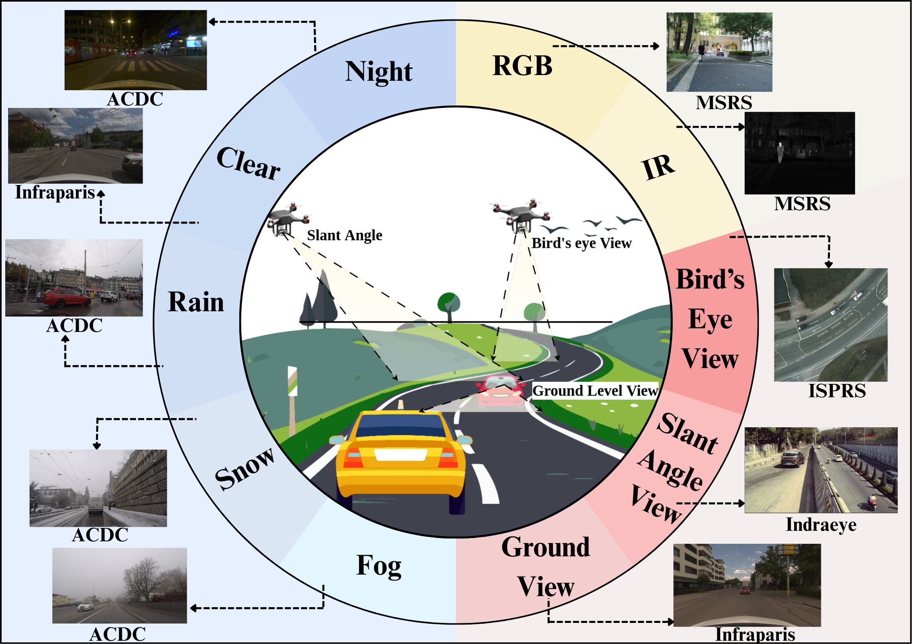

# Pixel2Perspective [ECCVW 2026]

**Pixel2Perspective: A Benchmark for Multi-Modal and Multi-View Generalization in Vision-Language Models**

Aditya Gandhamal<sup>2*</sup>, Aniruddh Sikdar<sup>1*</sup>, Arya Kishor<sup>1</sup>, Suresh Sundaram<sup>1</sup>

<sup>1</sup>Department of Aerospace Engineering, Indian Institute of Science, Bengaluru, India<br>
<sup>2</sup>Kotak IISc AI-ML Centre, Indian Institute of Science, Bengaluru, India<br>
<sup>*</sup>Equal contribution

**Accepted at the MARS2 Workshop, ECCV 2026**

[[🌐 Project Page](https://aniruddhsikdar1.github.io/publications/pixel2perspective/)] [[📄 Paper](https://openreview.net/pdf?id=DqDTS4Helq)] [[🖼️ Poster](https://drive.google.com/file/d/1ewpxw-fWrNhB_WiQZ6CqMCfK7w-7TCjM/view?usp=sharing)]



This is the official toolkit for **Pixel2Perspective**, a benchmark for multi-modal and multi-view
generalization in vision-language models, evaluating open-vocabulary semantic segmentation (OVSS) models
across viewpoints, sensor modalities, and out-of-distribution domains (MARS2 Workshop, ECCV 2026).

Pixel2Perspective extends [AetherVision-Bench](https://arxiv.org/abs/2506.03709) (its predecessor,
presented at the Workshop on Foundation Models Meet Embodied Agents (FMEA), CVPR 2025) from 6 to
**13 datasets**, spanning the same three viewpoint clusters — bird's-eye view,
slant-angle, ground-level — and two sensor modalities (RGB, infrared):

| Dataset       | Viewpoint    | RGB | IR |
|---------------|--------------|:---:|:--:|
| ISPRS Potsdam | Bird's-eye view | ✓ | – |
| WorldFloods   | Bird's-eye view | ✓ | – (IRRG composite) |
| LoveDA        | Bird's-eye view | ✓ | – |
| OpenEarthMap  | Bird's-eye view | ✓ | – (SAR sim-to-real) |
| UAVid         | Slant-angle  | ✓   | –  |
| IndraEye      | Slant-angle  | ✓   | ✓  |
| CART          | Slant-angle  | ✓   | ✓  |
| ACDC          | Slant-angle (adverse weather) | ✓ | – |
| MSRS          | Ground-level | ✓   | ✓  |
| MVSeg         | Ground-level | ✓   | ✓  |
| SemanticRT    | Ground-level | ✓   | ✓  |
| MFNet         | Ground-level | ✓   | ✓  |
| Infraparis    | Ground-level | ✓   | ✓  |

This toolkit follows the structure of [MESS](https://github.com/blumenstiel/MESS) and reuses
[AetherVision-Bench](https://arxiv.org/abs/2506.03709)'s conventions, so it is easy to plug into any detectron2-based
(or framework-agnostic) OVSS model.

## Usage

Follow [DATASETS.md](DATASETS.md) to download and prepare the datasets, then register them with
`import p2p.datasets`. If you are using detectron2, datasets register to the detectron2 `DatasetCatalog`;
otherwise `p2p.utils.catalog.DatasetCatalog` is used.

```sh
conda activate <your_env>

TEST_DATASETS="isprs_potsdam_sem_seg_test_rgb worldfloods_sem_seg_test_rgb loveda_sem_seg_test openearthmap_sem_seg_test_rgb openearthmap_sem_seg_test_sar uavid_sem_seg_val indraeye_sem_seg_test_rgb indraeye_sem_seg_test_ir cart_sem_seg_test_rgb cart_sem_seg_test_ir acdc_sem_seg_val msrs_sem_seg_test_rgb msrs_sem_seg_test_ir mvseg_sem_seg_test_rgb mvseg_sem_seg_test_ir semantic_rt_sem_seg_test_rgb semantic_rt_sem_seg_test_ir mfnet_sem_seg_test_rgb mfnet_sem_seg_test_ir infraparis_sem_seg_test_rgb infraparis_sem_seg_test_ir"

for DATASET in $TEST_DATASETS
do
 python evaluate.py --eval-only --config-file <your_config>.yaml --num-gpus 1 OUTPUT_DIR output/$DATASET DATASETS.TEST \(\"$DATASET\",\)
done
```

Combine results with:
```sh
python p2p/evaluation/pixel2perspective_evaluation.py --model_outputs output/<model_name> <...>
```

`Pixel2PerspectiveSemSegEvaluator` in `p2p.evaluation` provides CoI-mIoU (requires `detectron2`).

## MSRIQ (Multi-Source RGB-IR Uncertainty Quantification)

Unlike standard mIoU, MSRIQ does not need ground truth: it measures how much a model's predictions on the
RGB and IR frames of the *same* scene agree with each other (`p2p.evaluation.msriq`). A low MSRIQ means the
model behaves very differently across modalities for a scene it perceives identically to a human —
i.e. high cross-modal uncertainty. See [GettingStarted.md](GettingStarted.md) for usage.

## Summary

- [ ] Prepare the datasets as described in [DATASETS.md](DATASETS.md)
- [ ] Register the datasets by adding `import p2p.datasets` to your evaluation code
- [ ] Use the class names from `MetadataCatalog.get(dataset_name).stuff_classes` of each dataset
- [ ] Use `Pixel2PerspectiveSemSegEvaluator` as your evaluator class (optional, for CoI-mIoU)
- [ ] Optionally compute MSRIQ between paired RGB/IR predictions with `p2p.evaluation.compute_msriq`

## License

This code is released under the [MIT License](LICENSE). The evaluated datasets are released under their
respective licenses, see [DATASETS.md](DATASETS.md) for details. See [datasets.bib](datasets.bib) for the
dataset citations.

## Acknowledgement

This toolkit follows the structure and conventions of [MESS](https://github.com/blumenstiel/MESS)
(Blumenstiel et al., NeurIPS 2023) and its own predecessor,
[AetherVision-Bench](https://arxiv.org/abs/2506.03709). We thank the dataset providers for making their
data publicly available, and the authors of the evaluated OVSS models for releasing their code and weights.

## Citation

Accepted at the MARS2 Workshop, ECCV 2026:

```BibTeX
@inproceedings{gandhamal2026pixel2perspective,
  title={Pixel2Perspective: A Benchmark for Multi-Modal and Multi-View Generalization in Vision-Language Models},
  author={Gandhamal, Aditya and Sikdar, Aniruddh and Kishor, Arya and Sundaram, Suresh},
  booktitle={Proceedings of the European Conference on Computer Vision Workshops (ECCVW), 2nd Workshop on Multimodal Reasoning and Slow Thinking in the Large Model Era: Towards System 2 and Beyond},
  year={2026}
}
```
